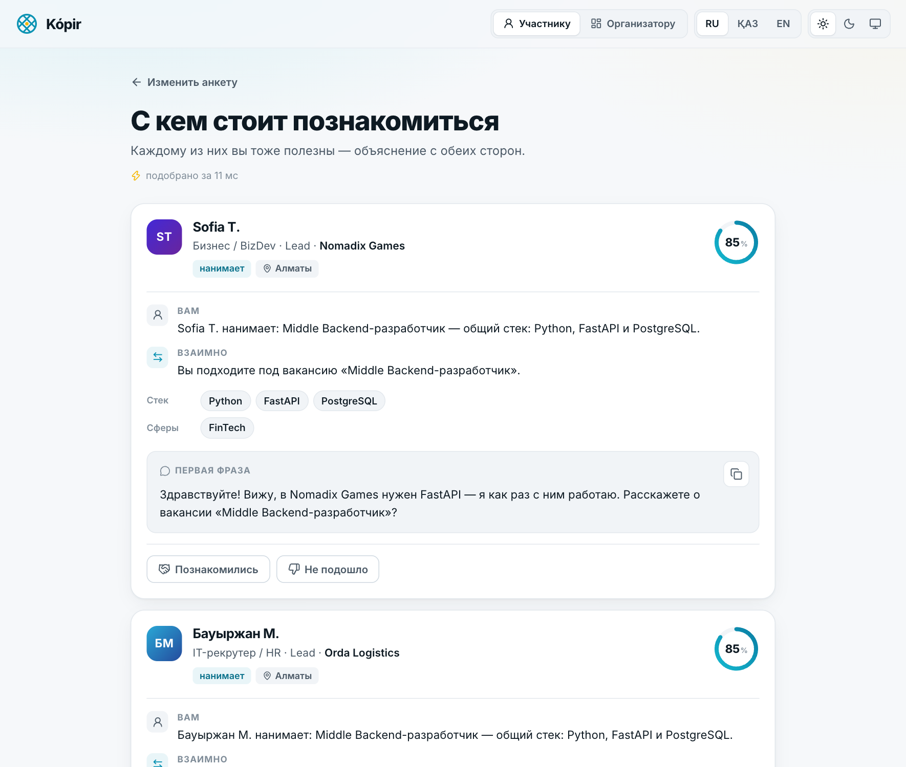
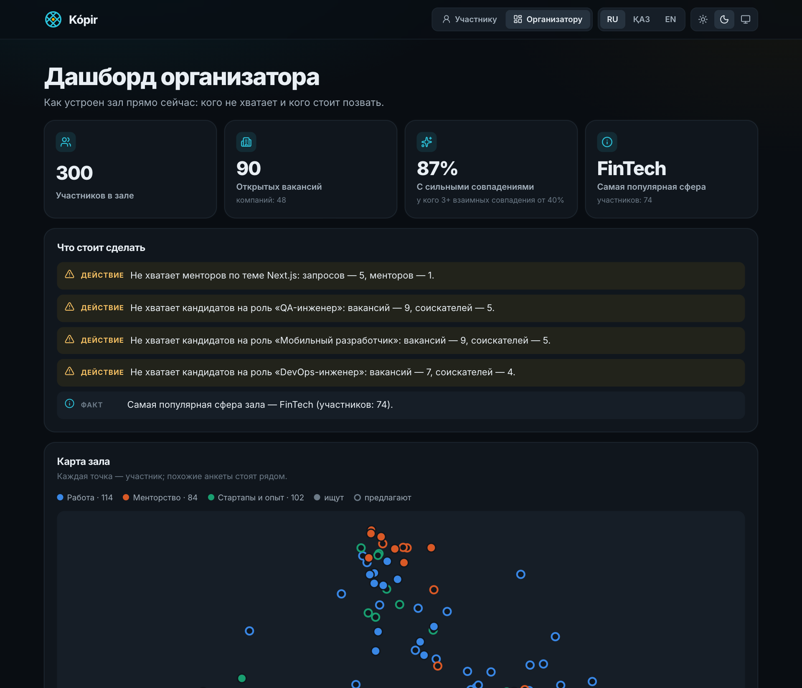
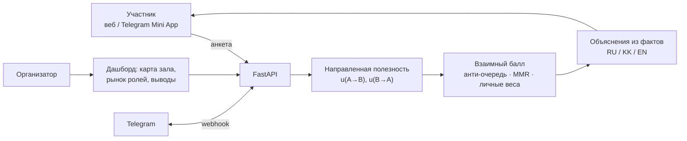
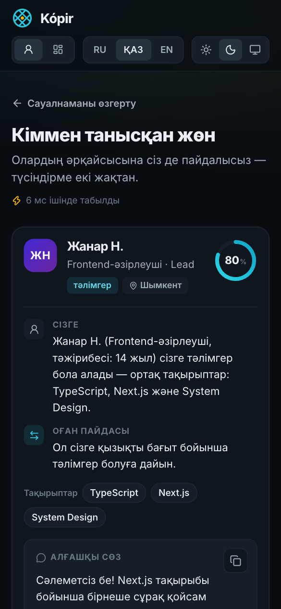

<div align="center">


# Kópir

**Знакомства на IT-мероприятиях, выгодные обоим**

Участник заполняет анкету — и меньше чем за секунду получает 5 человек, которым он тоже нужен,<br>
с объяснением с обеих сторон и готовой первой фразой. На русском, казахском и английском.

[**Открыть демо**](https://kopir.onrender.com) · [**Telegram-бот @KopirAgent**](https://t.me/KopirAgent) · [Дашборд организатора](https://kopir.onrender.com/?view=organizer) · [API](https://kopir.onrender.com/docs)

<sub>Кейс Qazaq IT Community «AI-сервис умного нетворкинга» · трек AI for Digital Economy & Smart Business · AIHack 2026, METU</sub>



</div>

> [!NOTE]
> Все 300 анкет — синтетические: имена, компании и контакты вымышлены и не содержат реальных персональных данных.

## Задача

На митап приходит 300+ человек, но знакомятся случайно: соискатель не находит нанимающих, джун — ментора, фаундер — партнёра. Типичное решение — «найти похожих» — здесь не работает: **нетворкинг — двусторонний рынок**, и соискателю нужен тот, кто нанимает, а не другой соискатель.

## Решение

1. **Направленная полезность.** Для каждой цели считаем, чем B полезен A: обязательные условия (нужная роль, ментор опытнее и закрывает тему, общее ремесло) и взвешенные критерии (стек, уровень, сферы). Каждое начисление сохраняется как факт.
2. **Взаимный балл** — гармоническое среднее `u(A→B)` и `u(B→A)`: если знакомство полезно только одной стороне, пара не поднимается.
3. **Справедливость зала.** Анти-очередь не даёт трём «звёздам» собрать все запросы; разнообразие выдачи (MMR) с гарантией: кандидат сильнее на 12+ п.п. никогда не окажется ниже.
4. **Объяснения из фактов:** «Вам: …» и «Взаимно: …», чипы совпадений, предупреждения. Текст не может сказать того, чего не посчитала модель.
5. **Первая фраза** выбирается по «лестнице» от самой конкретной: компания + самый редкий в зале общий навык → вакансия → общая фраза.
6. **Обратная связь** «познакомились / не подошло»: причина («не тот уровень / стек / сфера») усиливает этот критерий в личных весах, подборка сразу пересчитывается. Меняется только сторона «полезен мне» — чужие предпочтения не переписываются.
7. **Двойное согласие и маячок.** «Хочу познакомиться» → контакты открываются, только когда согласны оба (встречный запрос = согласие). Затем — маячок на весь экран: зона зала, цвет и крупный код, по которым люди находят друг друга в толпе из 300 человек, плюс приметы и Telegram.
8. **Голосовая анкета.** Рассказ о себе голосом (распознаёт браузер, на сервер уходит только текст) → роль, уровень, опыт, цель, стек и сферы заполняются сами (`backend/kopir/voice.py`).
9. **Мини-группы.** Для кофаундеров и обмена опытом — команда из 3–4 человек, где *каждая* пара взаимно полезна (жадный max-min по самому слабому звену, роли кофаундеров не повторяются). Для менторства — «круг ментора»: один ментор и 2–3 менти с общей темой, одна встреча вместо трёх. «Позвать всех» — то же двойное согласие.
10. **Расписание встреч 1:1:** слоты по 15 минут, у каждого не больше одной встречи в слот, пары не повторяются, у пары — зона зала. Встречи получают **99%** участников.
11. **Дашборд организатора:** карта зала-«созвездие» (линии — запланированные встречи, наведение подсвечивает пары человека), баланс соискателей и вакансий по ролям, спрос и предложение навыков, выводы («не хватает менторов по Next.js»), расписание.

## Метрики

Контрольный набор: **24 анкеты, не использованные при настройке**; 5 синтетических залов по 300 человек. «Подходит» решает судья — явные правила, независимые от формулы ранжирования (`backend/kopir/evaluation/judge.py`).

| Решение | ≥ 3 из 5 подходят | Точность@5 | Нарушения взаимности |
|---|:---:|:---:|:---:|
| «Похожие люди» — типичное решение | 4% | 11% | **75%** |
| Похожие + фильтр по целям | 56% | 56% | 0% |
| **Kópir** | **73%** | **74%** | **0%** |
| Потолок данных (идеальный ранжировщик) | 73% | — | — |

- Kópir работает **на потолке данных**: ни одной ошибки ранжирования на контрольном наборе.
- Анти-очередь: показов самого популярного участника **17 → 11**, охват зала **100%**.
- Ответ API — **~5 мс** (лимит ТЗ — 3 с). **169 автотестов**; тесты проверены намеренными поломками кода.

## Ограничения

- Качество подборки ограничено составом зала: для редких ниш (embedded, gamedev) подходящих людей может быть меньше трёх.
- Судья метрики — формальные правила, а не люди; казахские тексты вычитаны автором, но не профессиональным редактором.
- Свободный текст «о себе» показывается, но пока не участвует в подборе; веса критериев заданы экспертно.
- Запросы на знакомство хранятся в памяти сервера на время мероприятия; голосовой ввод работает в браузерах с Web Speech API (Chrome, Safari).
- Бесплатный хостинг засыпает после 15 минут простоя — первое открытие занимает около минуты.

<div align="center">
<br>
<sub>Дашборд организатора · <a href="https://kopir.onrender.com/?view=organizer">открыть</a></sub>
</div>

---

## Запуск

```bash
docker compose up --build          # http://localhost:8000 — интерфейс, /docs — API
```

<details>
<summary><b>Без Docker, тесты, оценка, Telegram-бот</b></summary>

```bash
# Сервер (Python 3.12, uv)
cd backend && uv sync
KOPIR_PROFILES=../data/profiles.json uv run uvicorn kopir.api.app:create_app --factory

# Интерфейс (Node 22+) — в другом терминале, проксирует /api на :8000
cd web && npm ci && npm run dev

# Тесты и оценка качества
cd backend && uv run pytest
uv run python scripts/evaluate.py --label check --queries holdout

# Telegram-бот локально (long polling): токен в .env, см. .env.example
docker compose --profile bot up
```

На хостинге бот работает в режиме webhook внутри того же сервиса: `KOPIR_BOT_MODE=webhook` (см. `render.yaml`).

</details>

<details>
<summary><b>API</b></summary>

| Метод | Путь | Что делает |
|---|---|---|
| `POST` | `/api/recommend` | Анкета → топ-K взаимно полезных людей с объяснениями. Принимает `lang`, `k`, `exclude` («показать ещё»), `feedback` (отзывы), `join` (добавить в зал). Контакты в ответе не отдаются. |
| `GET` | `/api/options?lang=kk` | Справочники формы: цели, роли, уровни, навыки, сферы. |
| `POST` | `/api/profiles` | Добавить анкету в зал (для знакомств). |
| `POST` | `/api/intros` | Запрос на знакомство; встречный запрос — двойное согласие, ответ с маячком. |
| `POST` | `/api/intros/{id}/respond` | Принять или отклонить входящий запрос. |
| `GET` | `/api/intros?profile_id=…` | Мои запросы; контакты — только у подтверждённых. |
| `POST` | `/api/squad` | Мини-группа: команда или круг ментора (`null`, если для цели групп нет). |
| `POST` | `/api/parse` | Свободный рассказ о себе → поля анкеты. |
| `GET` | `/api/dashboard?lang=ru` | Аналитика зала и расписание 1:1 для организатора. |
| `GET` | `/api/health` | Проверка сервиса. |

Интерактивная документация — [`/docs`](https://kopir.onrender.com/docs).

</details>

<details>
<summary><b>Архитектура и стек</b></summary>



- **Backend:** Python 3.12, FastAPI, Pydantic, NumPy, aiogram 3 · `uv`
- **Frontend:** React 19, TypeScript, Vite, Lucide, Inter — без внешних CDN, работает офлайн
- **Инфраструктура:** Docker (многоступенчатая сборка), Docker Compose, Render (Blueprint)

</details>

<details>
<summary><b>Данные</b></summary>

`data/profiles.json` и `data/profiles.csv` — 300 анкет, сгенерированных `backend/kopir/data/generator.py` (`scripts/export_profiles.py`):

- стеки взвешены по рынку (на Python пишут чаще, чем на C#);
- вакансии повторяют спрос зала, у компании 1–3 вакансии;
- технари-кофаундеры чаще ищут бизнес и продакта, бизнес — «любого технаря»;
- цели, уровни и языки (RU 55% · KK 25% · EN 20%) распределены по квотам.

Анкеты для оценки (`backend/eval/`) написаны вручную и в обучении не участвуют.

</details>

<details>
<summary><b>Структура репозитория</b></summary>

```
backend/kopir/
  taxonomy.py          роли, навыки, сферы, цели на трёх языках
  models.py            анкета: «кто я» + «кого ищу» (вакансии нанимающего)
  matching/            полезность, взаимный балл, обратная связь
  explain/             объяснения и первая фраза; тексты в locales/*.json
  evaluation/          судья, базовые решения, метрики
  meet.py              двойное согласие, маячок, расписание 1:1
  voice.py             рассказ о себе → поля анкеты
  squads.py            мини-группы: команда и круг ментора
  dashboard.py         аналитика зала
  bot/                 Telegram-бот (polling и webhook)
  api/                 FastAPI
web/src/               React-интерфейс, i18n, Telegram Mini App
data/                  синтетический зал (JSON, CSV)
docs/screenshots/      скриншоты для README и презентации
```

</details>

<div align="center">
<br>
<sub>Mini App в Telegram: язык, тема и имя — из профиля Telegram</sub>
</div>

## Лицензии и источники

Права на код принадлежат автору. Данные сгенерированы программно, реальные профили не использовались. Открытые зависимости: FastAPI, Pydantic, aiogram, React, Vite (MIT), Lucide (ISC), NumPy, Uvicorn (BSD), шрифт Inter (OFL).
